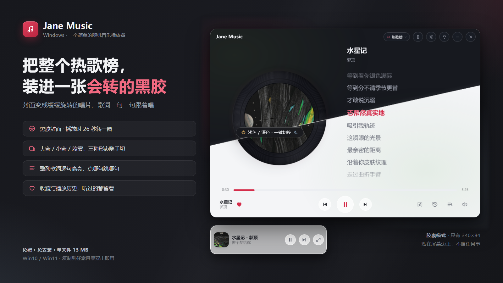

# Jane Music 4.0

<p align="center">
  
</p>

一个简单的随机音乐播放器：不用登录、不用建歌单，打开就是热歌榜随机播。Windows 单文件免安装，双击就响。

> 数据来自网易云公开接口，仅供学习交流，请支持正版。

## 从 2.0 到 4.0

这个项目的名字和 idea 不是 2026 年才有的——2022 年摸鱼的时候手搓过两版 [Jane·Music](https://fishpi.cn/article/1666707160861)（1.0 纯属摸鱼产物，2.0 加了置顶、进度条、设置页、托盘菜单，封面从方形变成了带羽化的圆形）。四年过去，工作里写了太多"正经"代码，反而更怀念那个随手搓出来就能听歌的小东西。

于是有了这版 4.0：同一个名字，同一种"打开就随机播"的听歌方式，从网页换成了 Tauri 2 + Vue 3 的桌面应用——算是对当年那个手搓版的正式续作与致敬。

## 它长什么样

| 大窗（860×600） | 小窗 | 胶囊 |
|---|---|---|
| 播放页：黑胶唱片 + 整列歌词 | 紧凑播放页 | 屏幕边缘的小胶囊 |

- 大窗：左侧封面变成缓缓旋转的黑胶（播放时 26 秒转一圈，窗口失焦自动停转省 CPU），右侧整列歌词逐句高亮，点哪句跳哪句
- 小窗：只保留封面、歌名和进度，占地方小
- 胶囊：340×84，贴在屏幕边上，不挡任何事，点击展开成大窗

## 功能

- 五个榜单随机抽歌：热歌榜、新歌榜、飙升榜、抖音热歌、怀旧经典，唱完自动连播，放不了自动跳过
- 歌词滚动跟随当前句，停靠在中间偏上一行；点任意一句直接跳转；纯音乐显示「请欣赏」
- 封面 / 音量滚轮切歌与调节（设置里可分别关闭）
- 收藏与播放历史：听过的都留着，随时翻出来重听
- 浅色 / 深色主题一键切换，跟随心意
- 窗口置顶、托盘常驻（点关闭是收进托盘，音乐不停）
- 快捷键：`空格` 播放/暂停，`N` 下一首
- 上次听的歌、音量、主题、榜单存在本地，重启接着听；封面与音源有磁盘缓存
- 榜单加载失败自动换源重试，死链自动记录跳过

## 下载使用

到 [Releases](../../releases) 下载 `JaneMusic.zip`，解压后双击 `Jane Music 4.0.exe` 即可：

- 免安装、免登录、单文件（约 13 MB），复制到任意目录都能用
- 需要 Windows 10 / 11（Win10 若无 WebView2 运行时，装包内附带的 `WebView2Loader.dll` 同目录即可，系统一般自带）
- 配置存在 `%APPDATA%\JaneMusic\`，音源与封面缓存在系统临时目录，删掉即清空

## 架构

```
┌─ Tauri 2 (Rust) ──────────────────────────┐
│  无边框透明窗口 / 托盘 / 单实例 / 本地流代理 │
│  127.0.0.1 HTTP 服务：代理音频与封面        │
│  （支持 Range/206，绕开 WebView2 外链限制） │
└──────────────┬────────────────────────────┘
               │ IPC
┌──────────────┴────────────────────────────┐
│  Vue 3 + Vite（web/）                      │
│  views: BigView / SmallView / MiniBar      │
│  lib: store / player / lyrics / modes ...  │
└───────────────────────────────────────────┘
```

- **外壳**：Tauri 2 + WebView2，无边框透明窗口、标题栏自绘，三种形态各自固定尺寸，单实例守卫
- **前端**：Vue 3 + Vite，`web/dist` 作为 frontendDist 打进 exe
- **音频流**：Rust 侧起本地 `127.0.0.1` HTTP 服务代理音频（支持 Range、206、长缓存），封面同理
- **数据源**：公开的 Meting 兼容接口（两个源互备），取网易歌单与歌词；后端拉榜后并发预筛死链
- **存储**：状态写 `%APPDATA%\JaneMusic\state.json`（临时文件 + rename 原子替换），死链记录存 localStorage

技术栈一句话：Rust / Tauri 2 / WebView2 / Vue 3 / Vite / reqwest / 本地 HTTP 流代理。

## 本地构建

依赖：Node 18+、Rust 1.77+（msvc 工具链）、WebView2。

```bash
# 前端
cd web
npm install
npm run build

# 回到根目录打包（release 必须带 custom-protocol，否则按 dev 模式起不来）
cd ..
cargo tauri build
# 或裸 cargo：
cargo build --release --features tauri/custom-protocol
```

产物在 `src-tauri/target/release/`，配套 `WebView2Loader.dll` 与 `发布/` 里的说明文档一起分发即可。

## 目录说明

```
web/            Vue 3 前端源码（views 三种形态 / components / lib 状态与播放逻辑）
src-tauri/      Rust 侧：窗口、托盘、本地流代理、IPC
tools/          打包脚本（publish.py：构建后打 zip 发布包）
发布/           发布附带文档：使用说明、应用介绍、更新说明
分享图/         README 与宣传用图
```

## 许可

代码仅供学习交流使用，音乐版权归网易云音乐及各版权方所有，请支持正版。
